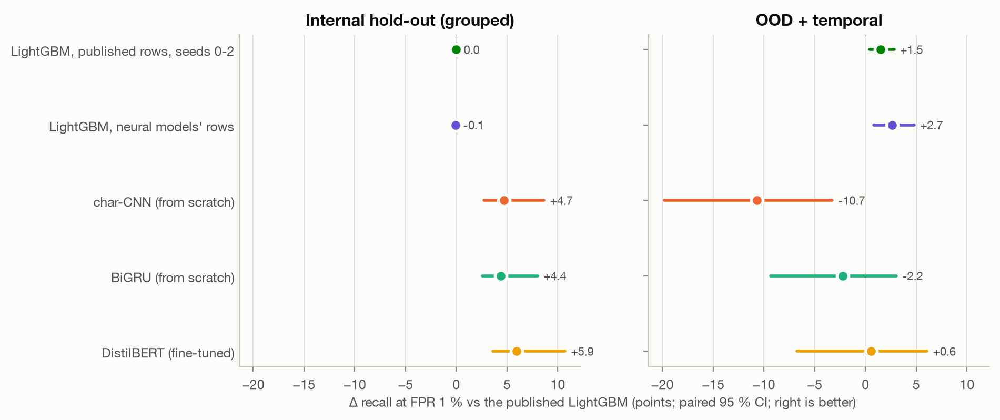
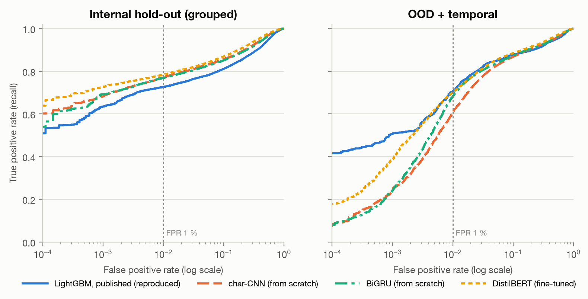
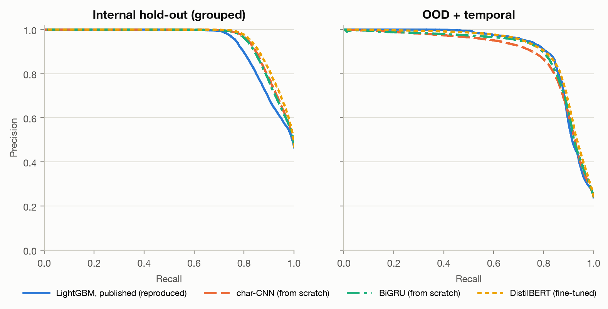

# Small Neural Models vs LightGBM for Phishing Detection — Evaluated Without Leaks

**Do small neural models beat gradient-boosted trees at detecting phishing from a host name, when
the evaluation cannot be gamed?** This repository trains a character-level CNN and a BiGRU from
scratch, fine-tunes DistilBERT, and compares all three against the LightGBM model of
[phishing-url-detector](https://github.com/Yoyagm/phishing-url-detector) on *that project's own
leak-free evaluation*, reproduced to the last digit. The result is reported as it came out.

<!-- BEGIN:headline -->
On the out-of-distribution + temporal test (131,396 hosts), the best small neural model, **DistilBERT (fine-tuned)**, reaches **71.1 % recall at a 1 % false-positive rate** (95 % CI [62.2, 78.7], mean of 3 seeds), against **70.5 %** for the published LightGBM: a paired difference of +0.6 points [-6.7, +6.1]. Against LightGBM trained on the same rows and averaged over the same seeds, the difference is -2.1 points [-8.3, +2.7].
<!-- END:headline -->

**Short answer: no.** Fine-tuned DistilBERT ties LightGBM out of distribution, the two models
trained from scratch lose there, and all three win clearly *in* distribution. Why that gap exists,
and what it implies for anyone choosing a model on an in-distribution score, is in
[What won, and why we think so](#what-won-and-why-we-think-so).

---

## The question

phishing-url-detector showed that the most widely used recent phishing-URL benchmark (PhiUSIIL,
UCI id 967) carries two label leaks, and that a host-name LightGBM evaluated without them reaches
**70.5 % recall at a 1 % false-positive rate** on phishing submitted two years after its training
data. That number is the bar here.

A tree model on 51 hand-built features is a strong, cheap baseline. The obvious question for anyone
who works with neural networks is whether a model that reads the raw characters — and so can learn
features nobody wrote down — does better. Published work on phishing-URL classification routinely
reports 99 %+ accuracy for neural models and trees alike, on evaluations of the kind
phishing-url-detector showed to be broken, so it settles nothing.

**The contribution of this repository is the comparison's rigour, not a winner.** Same split, same
test sets, same operating metric, several seeds, domain-level confidence intervals, paired tests,
and a baseline that must reproduce the published figures exactly before any comparison is allowed
to run.

## Method

### Data and splits — reused, not re-implemented

The canonicalisation, Public Suffix List, dataset assembly and LightGBM features are **vendored
byte-for-byte** from phishing-url-detector (`src/phishurl/`, pinned by SHA-256 in
`tests/test_vendored.py`). The splits are drawn with the same `GroupShuffleSplit`, seed and groups:

- **Rows are canonical host names**, never full URLs: the path, scheme and `www.` are where
  PhiUSIIL's collection artefact lives.
- **Grouped by registrable domain** (eTLD+1, ICANN section of the PSL): no domain appears on two
  sides of any split, so a model cannot be rewarded for memorising `*.web.app`.
- **Two test sets.** The *internal hold-out* is the grouped 20 % of PhiUSIIL. The
  *out-of-distribution + temporal* set pairs 100,000 Tranco hosts never seen in PhiUSIIL with
  PhishTank hosts submitted after PhiUSIIL's collection cutoff (2024-03-04); hosts on both lists
  are removed. The OpenPhish live feed is a third, phishing-only probe.
- **A validation split for early stopping** — the only addition — is carved out of the original
  training portion (10 % of its domains, grouped the same way). The test sets are never read
  during training.

<!-- BEGIN:sets -->
| Set | Hosts | Phishing | Registrable domains | Phishing in its 2 largest domains |
|---|---:|---:|---:|---|
| Training (neural models, LightGBM control) | 153,180 | 56,091 | 126,324 | 14.8 % (`firebaseapp.com` 5,418, `weeblysite.com` 2,889) |
| Validation (early stopping, threshold ablation) | 15,524 | 4,729 | 14,036 | 8.7 % (`netlify.app` 241, `cannca[.]shop` 172) |
| Internal hold-out (test) | 50,332 | 23,424 | 35,091 | 38.5 % (`web.app` 5,527, `repl.co` 3,498) |
| OOD + temporal (test) | 131,396 | 31,396 | 111,119 | 20.8 % (`weebly.com` 4,295, `wixstudio.com` 2,243) |
<!-- END:sets -->

The last column explains a feature of every result below: the internal hold-out's phishing is
dominated by two hosting platforms, so its confidence intervals are wide.

### Models

| Model | Input | What it is |
|---|---|---|
| LightGBM, published (reproduced) | 51 host features | The original model: same rows, parameters and seed 42. |
| LightGBM, published rows, seeds 0-2 | 51 host features | Same rows and parameters, other seeds: how much of 70.5 % is the seed. |
| LightGBM, neural models' rows | 51 host features | Trained on exactly the rows the neural models see (without the validation domains). |
| char-CNN | characters | Embeddings → parallel convolutions of width 2–5 → global max pool → MLP. Trained from scratch. |
| BiGRU | characters | Embeddings → bidirectional GRU → masked max + mean pool → MLP. Trained from scratch. |
| DistilBERT | WordPiece subwords | `distilbert-base-uncased` (pinned revision), fully fine-tuned with a one-logit head. |

Hyperparameters were fixed before any test result existed and were **not tuned**, on the test sets
or otherwise; they are listed in `src/phishsmall/neural.py`. Every neural model uses AdamW with
warm-up and linear decay, and keeps the weights of its best validation epoch (ROC-AUC on the
grouped validation split). DistilBERT is capped at **3 epochs** to keep each run under ~30 minutes
on an Apple M4; in practice every seed peaked after its first epoch and stopped after the second.
LoRA was not needed: full fine-tuning of 67 M parameters fits comfortably in 16 GB.

<!-- BEGIN:cost -->
| Model | Trainable parameters | Training rows | Device | Best epoch per seed | Validation ROC-AUC per seed | Training time per seed |
|---|---:|---:|---|---|---|---:|
| LightGBM, published (reproduced) | 300 trees × 31 leaves | 168,704 | cpu | — | in training data | 4 s |
| LightGBM, published rows, seeds 0-2 | 300 trees × 31 leaves | 168,704 | cpu | — | in training data | 11 s |
| LightGBM, neural models' rows | 300 trees × 31 leaves | 153,180 | cpu | — | 0.8399, 0.8396, 0.8397 | 4 s |
| char-CNN (from scratch) | 124,961 | 153,180 | mps | 16, 19, 12 | 0.8892, 0.8904, 0.8879 | 99 s |
| BiGRU (from scratch) | 55,457 | 153,180 | mps | 20, 16, 18 | 0.8850, 0.8852, 0.8842 | 2.7 min |
| DistilBERT (fine-tuned) | 66,954,241 | 153,180 | mps | 1, 1, 1 | 0.9027, 0.9036, 0.9037 | 19.2 min |
<!-- END:cost -->

### Metrics and uncertainty

- **Primary metric: recall at a 1 % false-positive rate**, as in the original. A false positive
  blocks a legitimate site, which is the costly error in deployment. ROC-AUC, recall at 0.1 % FPR
  and the absolute true/false positives at the operating point are reported alongside.
- **Three seeds** per trained model family (0, 1, 2); the table reports the mean and every seed.
- **95 % confidence intervals from 1,000 bootstrap resamples of registrable domains**, not of
  hosts: hosts under one domain are not independent, which is why the split is grouped in the
  first place. Each resample is shared by every model, so **differences are paired**.
- **The reproduction gate.** `make eval` refuses to run unless the reproduced LightGBM matches the
  published ROC-AUC and recall on both test sets to 1e-9:

<!-- BEGIN:reproduction -->
| Test set | Metric | Published (phishing-url-detector) | Reproduced here | Identical |
|---|---|---:|---:|:---:|
| Internal hold-out | ROC-AUC | 0.9186758425833806 | 0.9186758425833806 | yes |
| Internal hold-out | Recall @ FPR 1 % | 0.725922131147541 | 0.725922131147541 | yes |
| OOD + temporal | ROC-AUC | 0.9372024471270224 | 0.9372024471270224 | yes |
| OOD + temporal | Recall @ FPR 1 % | 0.705472034654096 | 0.705472034654096 | yes |
<!-- END:reproduction -->

## Results

<!-- BEGIN:results -->
| Model | Seeds | Test set | ROC-AUC [95 % CI] | Recall @ FPR 1 % [95 % CI] | Recall per seed | TP | FP | Recall @ FPR 0.1 % |
|---|---|---|---:|---:|---:|---:|---:|---:|
| LightGBM, published (reproduced) | 1 (42) | OOD + temporal | 0.9372 [0.912, 0.954] | **70.5 %** [61.2, 76.6] | — | 22,149 | 999 | 50.8 % |
| LightGBM, published rows, seeds 0-2 | 3 (0, 1, 2) | OOD + temporal | 0.9374 [0.912, 0.954] | **72.0 %** [62.1, 78.4] | 72.8 / 70.7 / 72.5 | 22,610 | 1,000 | 51.4 % |
| LightGBM, neural models' rows | 3 (0, 1, 2) | OOD + temporal | 0.9378 [0.912, 0.954] | **73.2 %** [62.9, 79.9] | 72.5 / 73.2 / 73.9 | 22,982 | 988 | 51.8 % |
| char-CNN (from scratch) | 3 (0, 1, 2) | OOD + temporal | 0.9360 [0.912, 0.952] | **59.9 %** [49.3, 69.1] | 57.2 / 60.7 / 61.8 | 18,800 | 1,000 | 22.4 % |
| BiGRU (from scratch) | 3 (0, 1, 2) | OOD + temporal | 0.9400 [0.917, 0.955] | **68.3 %** [58.9, 75.9] | 70.0 / 66.7 / 68.2 | 21,451 | 1,000 | 24.0 % |
| DistilBERT (fine-tuned) | 3 (0, 1, 2) | OOD + temporal | 0.9488 [0.929, 0.962] | **71.1 %** [62.2, 78.7] | 68.5 / 70.1 / 74.7 | 22,324 | 1,000 | 44.5 % |
| LightGBM, published (reproduced) | 1 (42) | Internal hold-out | 0.9187 [0.856, 0.949] | **72.6 %** [51.2, 83.0] | — | 17,004 | 269 | 63.5 % |
| LightGBM, published rows, seeds 0-2 | 3 (0, 1, 2) | Internal hold-out | 0.9186 [0.856, 0.949] | **72.6 %** [51.1, 83.0] | 72.5 / 72.6 / 72.6 | 17,001 | 269 | 62.9 % |
| LightGBM, neural models' rows | 3 (0, 1, 2) | Internal hold-out | 0.9185 [0.856, 0.949] | **72.5 %** [51.0, 82.9] | 72.4 / 72.5 / 72.6 | 16,985 | 268 | 63.2 % |
| char-CNN (from scratch) | 3 (0, 1, 2) | Internal hold-out | 0.9420 [0.897, 0.964] | **77.3 %** [59.7, 85.7] | 77.3 / 77.2 / 77.3 | 18,100 | 268 | 69.2 % |
| BiGRU (from scratch) | 3 (0, 1, 2) | Internal hold-out | 0.9391 [0.892, 0.962] | **77.0 %** [59.1, 85.6] | 76.9 / 77.1 / 76.9 | 18,027 | 269 | 68.8 % |
| DistilBERT (fine-tuned) | 3 (0, 1, 2) | Internal hold-out | 0.9501 [0.912, 0.969] | **78.5 %** [61.8, 86.7] | 78.8 / 78.4 / 78.4 | 18,395 | 269 | 72.3 % |
<!-- END:results -->

**In plain words:** the neural models are better at spotting phishing that resembles what they
were trained on, but on newer phishing mixed with the wider web none of them catches more than the
tree model at the same false-alarm budget — the best one only matches it.

TP and FP are counts at the operating point, averaged over seeds. FP sits near 1 % of the benign
hosts for every model by construction; recall is what differs. The intervals above are marginal and
wide — the internal ones especially, because two hosting platforms hold over a third of that set's
phishing — so they overlap even where one model is consistently ahead. The paired differences below
are what decide.

### Paired differences against LightGBM

<!-- BEGIN:deltas -->
| Model | Test set | Compared with | Δ recall @ FPR 1 % (pts) [95 % CI] | Δ ROC-AUC [95 % CI] | Resamples where the model is ahead |
|---|---|---|---:|---:|---:|
| char-CNN (from scratch) | OOD + temporal | vs published LightGBM | -10.7 [-19.8, -3.3] | -0.0012 [-0.0049, +0.0022] | 0 % |
| char-CNN (from scratch) | OOD + temporal | vs LightGBM control | -13.3 [-21.5, -7.0] | -0.0018 [-0.0053, +0.0015] | 0 % |
| BiGRU (from scratch) | OOD + temporal | vs published LightGBM | -2.2 [-9.3, +3.0] | +0.0028 [+0.0000, +0.0056] | 30 % |
| BiGRU (from scratch) | OOD + temporal | vs LightGBM control | -4.9 [-11.1, -0.6] | +0.0022 [-0.0004, +0.0050] | 0 % |
| DistilBERT (fine-tuned) | OOD + temporal | vs published LightGBM | +0.6 [-6.7, +6.1] | +0.0116 [+0.0075, +0.0169] | 60 % |
| DistilBERT (fine-tuned) | OOD + temporal | vs LightGBM control | -2.1 [-8.3, +2.7] | +0.0110 [+0.0070, +0.0164] | 30 % |
| char-CNN (from scratch) | Internal hold-out | vs published LightGBM | +4.7 [+2.7, +8.6] | +0.0233 [+0.0143, +0.0414] | 100 % |
| char-CNN (from scratch) | Internal hold-out | vs LightGBM control | +4.8 [+2.9, +8.8] | +0.0235 [+0.0144, +0.0418] | 100 % |
| BiGRU (from scratch) | Internal hold-out | vs published LightGBM | +4.4 [+2.6, +8.0] | +0.0204 [+0.0124, +0.0363] | 100 % |
| BiGRU (from scratch) | Internal hold-out | vs LightGBM control | +4.4 [+2.7, +8.1] | +0.0206 [+0.0125, +0.0368] | 100 % |
| DistilBERT (fine-tuned) | Internal hold-out | vs published LightGBM | +5.9 [+3.6, +10.7] | +0.0314 [+0.0194, +0.0556] | 100 % |
| DistilBERT (fine-tuned) | Internal hold-out | vs LightGBM control | +6.0 [+3.8, +10.8] | +0.0316 [+0.0195, +0.0563] | 100 % |
| *LightGBM, published rows, seeds 0-2* | OOD + temporal | vs published LightGBM | +1.5 [+0.4, +2.8] | +0.0002 [+0.0000, +0.0004] | 100 % |
| *LightGBM, neural models' rows* | OOD + temporal | vs published LightGBM | +2.7 [+0.8, +4.8] | +0.0006 [+0.0003, +0.0009] | 100 % |
<!-- END:deltas -->







### OpenPhish live feed

Phishing-only, so only the detection rate at each model's OOD operating point is defined. The
original reported 58.5 % over URL rows; several rows share a host, so the per-host rate is also given.

<!-- BEGIN:openphish -->
| Model | Detected, per host (n = 260) | Detected, per URL row (n = 299) |
|---|---:|---:|
| LightGBM, published (reproduced) | 61.9 % | 58.5 % |
| LightGBM, published rows, seeds 0-2 | 64.0 % | 60.4 % |
| LightGBM, neural models' rows | 69.1 % | 65.1 % |
| char-CNN (from scratch) | 52.4 % | 49.3 % |
| BiGRU (from scratch) | 63.5 % | 59.9 % |
| DistilBERT (fine-tuned) | 72.9 % | 67.0 % |
<!-- END:openphish -->

## Ablations

### Fixing the threshold where a deployer would have to

Recall at 1 % FPR reads the threshold off the test set's own ROC curve — the standard definition,
and what the table above reports. A deployed model must fix its threshold in advance. Here it is
fixed on the grouped validation split at 1 % FPR and carried unchanged to the OOD set. The LightGBM
runs trained on the validation domains are left out, since for them it is not held out:

<!-- BEGIN:threshold -->
| Model | OOD recall, threshold read off the OOD curve | OOD recall, threshold fixed on validation | OOD FPR actually incurred | False positives per 100,000 benign |
|---|---:|---:|---:|---:|
| LightGBM, neural models' rows | 73.2 % | 85.7 % | **6.56 %** | 6,560 |
| char-CNN (from scratch) | 59.9 % | 87.7 % | **11.96 %** | 11,964 |
| BiGRU (from scratch) | 68.3 % | 87.5 % | **10.12 %** | 10,122 |
| DistilBERT (fine-tuned) | 71.1 % | 89.6 % | **12.43 %** | 12,426 |
<!-- END:threshold -->

### Skipping the "already seen" filter

phishing-url-detector removed from the OOD set every Tranco host that also appears in PhiUSIIL
(about 42 % of an unfiltered sample). Leaving them in — the naive evaluation — inflates every
model, and not equally:

<!-- BEGIN:unfiltered -->
| Model | Recall @ FPR 1 %, seen hosts removed | Recall @ FPR 1 %, seen hosts kept | Inflation (pts) | ROC-AUC inflation |
|---|---:|---:|---:|---:|
| LightGBM, published (reproduced) | 70.5 % | 73.0 % | +2.4 | +0.0039 |
| LightGBM, published rows, seeds 0-2 | 72.0 % | 74.4 % | +2.4 | +0.0039 |
| LightGBM, neural models' rows | 73.2 % | 74.5 % | +1.3 | +0.0038 |
| char-CNN (from scratch) | 59.9 % | 64.4 % | +4.5 | +0.0056 |
| BiGRU (from scratch) | 68.3 % | 72.0 % | +3.7 | +0.0049 |
| DistilBERT (fine-tuned) | 71.1 % | 73.8 % | +2.7 | +0.0048 |
<!-- END:unfiltered -->

### What the false positives look like

The benign OOD hosts each model flags at its 1 %-FPR operating point, against the benign set as a
whole:

<!-- BEGIN:false_positives -->
| Benign hosts | Count | Contain a digit | Punycode (`xn--`) | Contain a hyphen | Mean length |
|---|---:|---:|---:|---:|---:|
| All benign OOD hosts | 100,000 | 9.6 % | 0.1 % | 8.4 % | 12.7 |
| Flagged by LightGBM, published (reproduced) | 999 | 64.5 % | 10.7 % | 25.3 % | 15.5 |
| Flagged by LightGBM, published rows, seeds 0-2 | 1,000 | 58.8 % | 11.3 % | 20.5 % | 15.4 |
| Flagged by LightGBM, neural models' rows | 988 | 61.0 % | 10.3 % | 20.1 % | 15.3 |
| Flagged by char-CNN (from scratch) | 1,000 | 85.2 % | 10.7 % | 31.7 % | 15.7 |
| Flagged by BiGRU (from scratch) | 1,000 | 82.1 % | 10.4 % | 32.0 % | 16.2 |
| Flagged by DistilBERT (fine-tuned) | 1,000 | 71.9 % | 12.1 % | 29.2 % | 16.1 |
<!-- END:false_positives -->

## What won, and why we think so

**The answer to the question is no.** Out of distribution, at the operating point, no small neural
model beats LightGBM. Fine-tuned DistilBERT *ties* it: its recall at 1 % FPR is statistically
indistinguishable from both the published LightGBM and the LightGBM control (both paired intervals
straddle zero). The two models trained from scratch do worse — the char-CNN clearly, the BiGRU
against the control. **In distribution, all three neural models win clearly**: on the internal
hold-out they beat LightGBM by several points with paired intervals well clear of zero, and
DistilBERT has the highest ROC-AUC on both test sets. A lead of several points in distribution
shrinks to nothing, or reverses, out of distribution. That gap is the finding.

What we think explains it — consistent with the tables above, not proven by them:

1. **The gap sits at the strict end of the ROC curve.** On ROC-AUC the neural models match or beat
   LightGBM out of distribution; DistilBERT's AUC gain even has an interval clear of zero. The
   difference is in the few hundred benign hosts each model scores *highest*: at 0.1 % FPR every
   neural model catches less phishing than LightGBM, the character models far less. On the
   log-scale ROC plot, LightGBM is far ahead below roughly 0.3 % FPR; DistilBERT catches up around
   there, the character models only at a few percent. An operational metric exposes what AUC
   averages away.
2. **The benign hosts they flag look machine-generated.** Among the benign hosts each model flags
   at 1 % FPR, the share containing digits or hyphens is several times the base rate for every
   model — highest for the character models, lower for DistilBERT, lowest for LightGBM — and
   punycode names, almost absent from the benign set, are heavily over-represented for all. In
   PhiUSIIL, random-looking strings are a strong phishing cue; in Tranco's long tail they are also
   CDN shards, trackers and internationalised names. A model that reads raw characters learns that
   cue more sharply than 51 coarse features do. Subword pretraining appears to temper it, not remove it.
3. **The character models memorise more.** Leaving already-seen hosts in the OOD set inflates the
   char-CNN and BiGRU more than LightGBM; DistilBERT is inflated about as much as LightGBM.
   Without the parent project's filter, the from-scratch models would have looked better than
   they are.
4. **Seeds matter as much as architectures at this operating point.** Re-seeding the published
   LightGBM on the same rows moves its OOD recall by about two points, and the published 70.5 % is
   the lowest of its four seeds. DistilBERT's three seeds spread even wider — one single run lands
   below the published number, another well above it. A one-seed comparison could have reported
   either a win or a loss; this is why every model has three seeds and two LightGBM references.
5. **No model keeps its promise when the threshold is fixed in advance.** Calibrated at 1 % FPR on
   held-out validation data, every model incurs several times that rate on the OOD set, and the
   neural models more than LightGBM. The headline recall figures, ours and the parent's alike,
   assume an operating point nobody could have chosen beforehand.

On the small OpenPhish probe DistilBERT detects the most phishing; with 260 hosts and no benign
counterpart, that is weak evidence either way. And matching LightGBM costs DistilBERT two orders of
magnitude more training time, a GPU, and a 67 M-parameter model where 300 trees suffice.

What this does **not** show: that neural models cannot win here. They were not tuned, saw one
dataset, and read host names only. It shows that on this evaluation, with these budgets, a model
that wins in distribution can tie or lose where it would be deployed — and that only an
out-of-distribution test at an operational metric, with several seeds, would have revealed it.

## Limitations

- **Host names only.** No path, page content, certificate or DNS signal. This is forced by the
  dataset's leaks, and it caps what any model here can learn.
- **One training dataset.** Every model learns from PhiUSIIL's hosts. A neural model with more
  capacity might benefit more from a larger, cleaner corpus than LightGBM would; this study cannot
  say.
- **One capture date.** The OOD and OpenPhish sets are the 2026-08-14 capture of live feeds.
  Another capture will give different numbers.
- **Three seeds.** Enough to see that seed variation is not negligible at this operating point,
  not enough to characterise it. Domain-level bootstrap intervals cover test-set sampling only,
  not training randomness; the per-seed column shows the latter directly.
- **No hyperparameter search.** A tuned neural model could do better. So could a tuned LightGBM.
  Neither was tuned, deliberately, so the comparison is between equally untuned models.
- **MPS non-determinism.** Neural runs on Apple-silicon GPUs are seeded but not bit-reproducible;
  re-running may move the neural numbers in the last digits. The LightGBM numbers are exact.
- **DistilBERT capped at 3 epochs** for compute (it stopped early anyway); every model's
  per-epoch validation curve is in `reports/results.json`.

## Reproduce

Python 3.12 with [uv](https://docs.astral.sh/uv/). One command from a fresh clone, with the
2026-08-14 capture of the raw data (see *Data* below for why it must be that capture):

```bash
make setup && make data COPY_FROM=<path-to>/phishing-url-detector/data/raw && make splits train eval tables test
```

| Step | What it does | Time on an M4 |
|---|---|---|
| `make data` | download or copy the raw inputs, then verify them against `data/SHA256SUMS` | seconds |
| `make splits` | build all sets with the vendored code, cached in `data/processed/` | ~10 s |
| `make train` | every model and seed; skips runs whose scores exist, so it resumes | ~1.5 h |
| `make train-fast` | everything but DistilBERT | ~15 min |
| `make eval` | gate on the reproduction, metrics, 1,000 bootstrap resamples, ablations, figures | ~2 min |
| `make tables` | rewrite every table and the headline in this README from `reports/results.json` | instant |
| `make test` | unit tests; real-data tests are skipped when the data is absent | seconds |

Every number in this README lives between `<!-- BEGIN/END -->` markers and is regenerated by
`make tables`; a test fails if the README and `reports/results.json` disagree.

A fresh download is possible (`make data` without `COPY_FROM`), but it will not be the 2026-08-14
capture, and PhishTank asks automated clients to register for an application key: anonymous
downloads are limited to a few per day. If the download fails or is throttled, copy an existing
capture with `make data COPY_FROM=<dir>` (or `scripts/fetch_data.py --copy-from <dir>`).

### Reproducibility checklist

- [x] **One command** from a clone with the data capture: `make setup data splits train eval tables test`.
- [x] **Pinned environment:** Python 3.12, `uv.lock`; LightGBM, scikit-learn, NumPy and pandas at
  the parent project's exact versions.
- [x] **Pinned inputs:** raw files checked against `data/SHA256SUMS`; the Public Suffix List and
  brand list are frozen in `data/`; DistilBERT is loaded at a pinned Hub revision.
- [x] **Pinned code of the parent:** `src/phishurl/` is byte-identical to the parent, checked by test.
- [x] **Same evaluation sets:** every set's SHA-256 fingerprint (hosts and labels) is recorded in
  `reports/results.json`, so a re-run can prove it evaluated the same hosts.
- [x] **Reproduction gate:** `make eval` stops unless the re-trained LightGBM matches the
  published metrics to 1e-9.
- [x] **Fixed seeds** for splits (42), training (0, 1, 2; 42 for the published baseline) and the
  bootstrap; evaluation output is byte-identical across runs.
- [x] **Generated reporting:** tables, headline and figures come from `reports/results.json` and
  the stored scores; nothing is typed by hand.
- [ ] **Bit-exact neural training:** not guaranteed on Apple-silicon GPUs (MPS); see *Limitations*.

## Relationship to phishing-url-detector

[phishing-url-detector](https://github.com/Yoyagm/phishing-url-detector) is the parent project:
it found the two label leaks in PhiUSIIL, defined the leak-free host-name evaluation, and shipped
an explainable LightGBM with an in-browser demo. This repository asks the next question on the
same ground. It vendors the parent's data code unchanged instead of re-implementing it, re-trains
the parent's model and checks it against the parent's published numbers before comparing anything,
and changes the evaluation in only two ways: a validation split for early stopping, and confidence
intervals with paired tests that the parent did not report.

Because `src/phishurl/` is kept byte-identical, its docstrings still refer to files of the parent
repository (for example `docs/app.js`, `scripts/leak_audit.py`, `tests/test_no_host_leakage.py`)
that do not exist here; they are in the parent project.

## Data

No third-party dataset is redistributed here. `make data` fetches the raw inputs and checks them
against the SHA-256 of the 2026-08-14 capture. The phishing feeds rotate within hours, so a fresh
download will not match: the script says so and stops, rather than letting a different snapshot
pass for the published one. Only aggregate metrics computed on the feeds are published; no
PhishTank or OpenPhish URL or host appears in this repository. Dedicated phishing domains named in
the tables are defanged (`example[.]shop`); abused hosting platforms are named as they are.

| Source | Use | Terms |
|---|---|---|
| PhiUSIIL Phishing URL Dataset — A. Prasad and S. Chandra, [UCI Machine Learning Repository, id 967](https://archive.ics.uci.edu/dataset/967/phiusiil+phishing+url+dataset); paper: *Computers & Security* 136 (2024), [doi:10.1016/j.cose.2023.103545](https://doi.org/10.1016/j.cose.2023.103545) | training, internal hold-out | [CC BY 4.0](https://creativecommons.org/licenses/by/4.0/), as stated on the UCI page; used with attribution, not redistributed |
| Tranco top-1M list — Le Pochat et al., NDSS 2019 | benign side of the OOD set | see the terms at <https://tranco-list.eu/>; not confirmed here; not redistributed |
| PhishTank verified online dump, operated by Cisco Talos | phishing side of the OOD set, by submission time | Per the [PhishTank FAQ](https://phishtank.org/faq.php), the data is free and API use is allowed for commercial and non-commercial purposes; per the [developer page](https://phishtank.org/developer_info.php), automated downloads need a registered application key (otherwise a few downloads per day) and a descriptive User-Agent. Redistribution terms: see <https://phishtank.org/>; not confirmed here. Not redistributed |
| OpenPhish community feed | independent phishing probe | Per the [OpenPhish Terms of Use](https://openphish.com/terms.html): personal use; academic, independent or personal research allowed if it does not support an organisation's business operations; no commercial use; no distribution of the information to third parties without written consent. Not redistributed |
| Public Suffix List (`data/public_suffix_list.dat`) | registrable domains | [MPL 2.0](https://mozilla.org/MPL/2.0/); frozen snapshot vendored from the parent |
| Brand list (`data/brand_tokens.txt`) | one LightGBM feature | 400 brand tokens frozen from the Tranco top 1,000, vendored from the parent |

## Dependencies

| Package | Why |
|---|---|
| `lightgbm`, `scikit-learn`, `numpy`, `pandas` | Pinned to the parent's exact versions: the baseline must reproduce its numbers to 1e-9, and the split and metric code come from these. |
| `torch` | Trains the neural models on the Apple-silicon GPU (MPS) with a CPU fallback; the de-facto standard, with no extra training framework on top. |
| `transformers` | Loads the pretrained DistilBERT and its tokenizer at a pinned revision; nothing else in the ecosystem is used. |
| `matplotlib` | Draws the figures with the parent's styling module. |
| `pytest` | Test runner (development only). |

LightGBM and PyTorch ship different OpenMP runtimes, and on macOS a process that loads both crashes
or deadlocks; the code never imports them into the same process (`src/phishsmall/neural.py`).

## Layout

```
src/phishurl/      vendored from phishing-url-detector, byte-identical (canonicalise, PSL, features, datasets)
src/phishsmall/    splits · metrics · encoding · models · training · neural · baseline · train · evaluation · figures · tables · defang
scripts/           fetch_data.py
tests/             splits · metrics · neural models · baseline determinism · tables · vendored-file hashes
reports/           results.json — every number in this README
figures/           generated by `make eval`
MODEL_CARD.md      intended use, data, metrics, limits and risks
```

## License

MIT — see [LICENSE](LICENSE).
